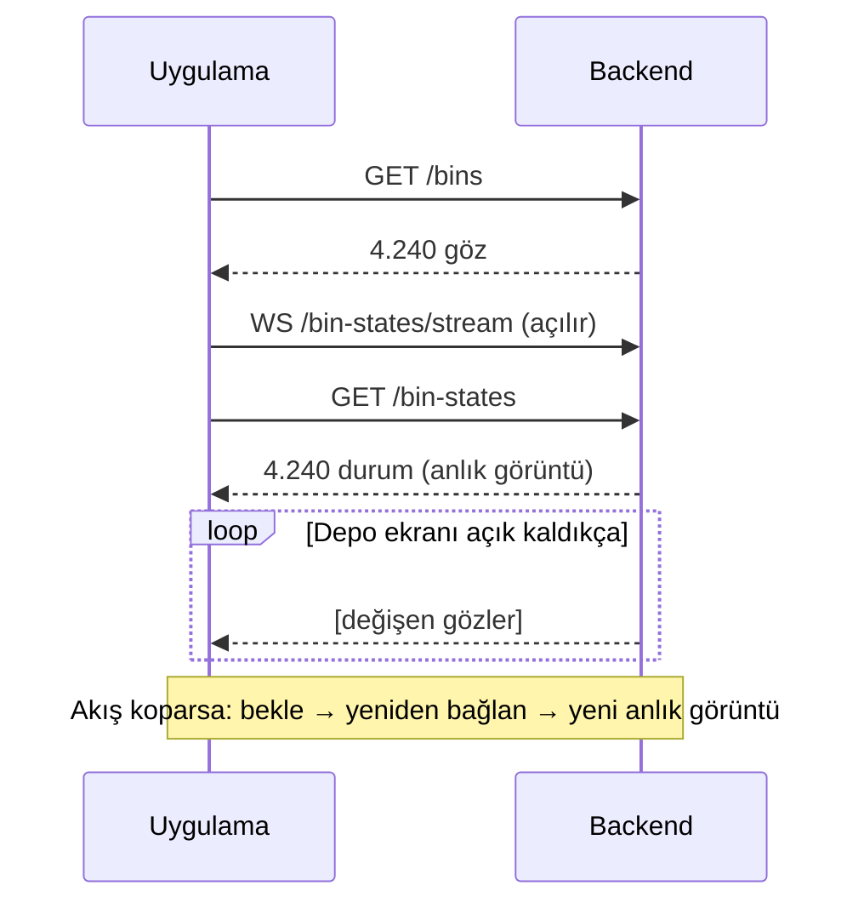

# Depo İçi – WMS Entegrasyon Sözleşmesi

GES-02 dijital ikizindeki depo içi görünümünün backend'den beklediği veriyi tanımlar. Uygulamada doğrulama, eşleme, renklendirme ve yeniden bağlanma hazırdır; bu belgeye uyan bir backend için yalnızca adresleri ve akış yöntemini içeren küçük bir adapter eklenir. Şu an yerine aynı biçimde veri üreten bir demo akışı çalışır.

| | |
|---|---|
| Kapsam | 4 depo (DEPO 1–4) × 5 kat × 212 göz = **4.240 göz** |
| Uygulama tarafı | `src/services/warehouseStockService.ts` (adapter ve doğrulama) |

---

## 1. Özet

Raflar, koridorlar ve katlar uygulamada sabittir; backend'den gelmez. Backend yalnızca iki şey söyler: **hangi göz nerede ve kaç palet alır** (göz listesi), **gözde şu an kaç palet var** (durum).

| # | Uç (öneri) | Ne zaman | İçerik |
|---|---|---|---|
| 1 | `GET /api/wms/bins` | Depo ekranı her açıldığında bir kez | Tüm gözler: kimlik, konum, kapasite |
| 2 | `GET /api/wms/bin-states` | Bağlanınca ve her yeniden bağlanmada | Tüm gözlerin anlık palet sayısı |
| 3 | `WS /api/wms/bin-states/stream` | Sürekli | Yalnızca değişen gözler |

Uç adları önerilir; değişebilir. Değişmemesi gereken, aşağıdaki **içerik ve kurallardır**.



Akış, anlık görüntüden **önce** açılır; arada oluşan değişiklik kaybolmaz. İkisinde aynı göz gelirse `updatedAt` değeri yeni olan kazanır (bkz. §5).

---

## 2. Göz modeli

**Göz (bin)**, bir katta koridordan arkaya uzanan ve paletlerin arka arkaya dizildiği hattır. Uygulama her gözü tek bir renkli şerit olarak gösterir. Boyut, hacim ve ağırlık kullanılmaz.

Bir göz üç kodla bulunur:

| Kod | Alan | Değer | Anlamı |
|---|---|---|---|
| Depo | `Warehouse → Code` | `"1"` – `"4"` | DEPO 1 kuzeybatı, 2 kuzeydoğu, 3 güneybatı, 4 güneydoğu |
| Kat | `Warehouse Tier - Tier → Code` | `1` – `5` | 1 = en alt kat |
| Göz | `Warehouse Bin - Bin → Code` | `1` – `212` | Kat içindeki sıra, aşağıdaki kurala göre |

### Göz numaralandırma kuralı

Her depoda iki koridor (A1, A2), her koridorun iki yüzü (batı, doğu), her yüzde 53 göz vardır. Numaralar **her katta aynı** düzende verilir; 1. göz ana koridora en yakın olandır:

| Göz no | Koridor | Yüz |
|---|---|---|
| 1 – 53 | A1 | batı |
| 54 – 106 | A1 | doğu |
| 107 – 159 | A2 | batı |
| 160 – 212 | A2 | doğu |

Örnek: `2-3-120` → DEPO 2, 3. kat, A2 koridoru batı yüzü, ana koridordan 14. göz.

Raf kirişlerinde aynı göz `D2 R120 K3` (depo, göz, kat) olarak yazar. Backend'deki numaralandırma bu tablodan farklıysa entegrasyondan **önce** bildirilmelidir. Uygulamada kural tek dosyada (`src/data/warehouseLanes.ts`) tanımlıdır.

---

## 3. Uç 1 – Göz listesi

`GET /api/wms/bins` → `200`, gövde: **JSON dizisi**, her göz bir kez.

```json
[
  {
    "ID": "39",
    "Code": "1-1-1",
    "Max Pallet Count": "8",
    "Warehouse → Code": "1",
    "Warehouse → Name": "SOĞUK HAVA DEPO - 1",
    "Warehouse Tier - Tier → Code": "1",
    "Warehouse Tier - Tier → Name": "1.Raf",
    "Warehouse Bin - Bin → Code": "1"
  }
]
```

Alan adları WMS dışa aktarımıyla aynıdır (`→` dahil). Listede olmayan alanlar (`Max Height`, `Row`, `Bay` vb.) gönderilebilir; yok sayılır.

| Alan | Zorunlu | Tür | Kural |
|---|---|---|---|
| `ID` | evet | metin veya sayı | Gözün kalıcı kimliği. Durum kayıtları buna başvurur. Değişmemeli. |
| `Code` | evet | metin | `depo-kat-göz`, ör. `1-1-1`. Aramada ve ekranda kullanılır. |
| `Max Pallet Count` | evet | tam sayı (metin olabilir) | 1 – 255. Göz bu sayıya ulaşınca **dolu** sayılır. |
| `Warehouse → Code` | evet | metin | Tam olarak `"1"`, `"2"`, `"3"` veya `"4"`. **`"01"` eşleşmez.** |
| `Warehouse Tier - Tier → Code` | evet | tam sayı (metin olabilir) | 1 – 5 |
| `Warehouse Bin - Bin → Code` | evet | tam sayı (metin olabilir) | 1 – 212 |
| `Warehouse → Name` | hayır | metin | Gösterim amaçlı |
| `Warehouse Tier - Tier → Name` | hayır | metin | Gösterim amaçlı, ör. `1.Raf` |

Kurallar:

- Aynı (depo, kat, göz) üçlüsü **bir kez** gelir. İkincisi reddedilir.
- Sayılar `"8"` veya `8` olarak gelebilir. Baştaki boşluklar kırpılır.
- Kat ve göz kodunda baştaki sıfırlar sorun değildir (`"007"` = 7).

---

## 4. Uç 2 – Anlık durum

`GET /api/wms/bin-states` → `200`, gövde: **JSON dizisi**, listedeki **her göz için** bir kayıt.

```json
[
  { "binId": "39", "palletCount": 5, "updatedAt": "2026-10-26T14:21:45+03:00" },
  { "binId": "40", "palletCount": 0, "updatedAt": "2026-10-26T13:02:11+03:00" }
]
```

| Alan | Zorunlu | Tür | Kural |
|---|---|---|---|
| `binId` | evet | metin veya sayı | Göz listesindeki `ID` |
| `palletCount` | evet | tam sayı (metin olabilir) | 0 ≤ değer ≤ `Max Pallet Count` |
| `updatedAt` | evet | ISO 8601, saat dilimli | **Değişikliğin WMS'te gerçekleştiği an.** Yanıtın gönderildiği an değil. |

Kurallar:

- Anlık görüntü **tüm** gözleri içerir. Durumu gelmeyen göz ekranda "veri yok" (gri) görünür; boş sayılmaz.
- Renk palet sayısından türetilir: `0` boş (yeşil), `1 … kapasite−1` kısmi (sarı), `kapasite` dolu (kırmızı). Backend renk veya durum adı göndermez.
- Depo rengi (palet ÷ kapasite) de uygulamada hesaplanır: %70 altı yeşil, %70–90 sarı, %90 ve üstü kırmızı.

---

## 5. Uç 3 – Değişiklik akışı

### Tercih: WebSocket (veya SSE)

`WS /api/wms/bin-states/stream`. Her mesaj, §4'teki kayıtlardan oluşan bir **JSON dizisidir**; yalnızca değişen gözleri içerir. Tek değişiklik de dizi içinde gönderilir:

```json
[{ "binId": "39", "palletCount": 6, "updatedAt": "2026-10-26T14:22:03+03:00" }]
```

- Aynı anda değişen gözler tek mesajda toplanabilir. Uygulama gelen mesajları zaten 250 ms'lik paketlere birleştirir.
- Sunucu bağlantıyı kapatabilir. Uygulama yeniden bağlanır ve yeni anlık görüntü alır, kaçan bir şey kalmaz.

### Alternatif: Polling

Anlık itme mümkün değilse aynı uç filtreyle sorgulanır:

`GET /api/wms/bin-states?updatedSince=2026-10-26T14:22:03+03:00`

- Dönen kayıtlar: `updatedAt >= updatedSince` olan gözler. Sınır **dahildir**; tekrar gelen kayıt zararsızdır.
- Uygulama `updatedSince` olarak aldığı en büyük `updatedAt` değerini gönderir. Böylece istemci ile sunucu saati arasındaki fark sorun olmaz.
- Önerilen aralık: 3–5 saniye.

### Sıra ve tekrar

Mesajların sırayla gelmesi gerekmez. Uygulama her gözde `updatedAt` değeri daha eski olan kaydı **atar**; eşit veya yeni olanı uygular. Bu yüzden:

- `updatedAt` her değişiklikte doğru ve artan olmalıdır.
- Aynı kaydın tekrar gönderilmesi güvenlidir.

---

## 6. Hatalar ve dayanıklılık

| Durum | Backend | Uygulama |
|---|---|---|
| Uç hata verir | `4xx`/`5xx` döner (hata `200` içinde gönderilmez) | 1 sn'den başlayıp 30 sn'ye kadar artan beklemeyle yeniden dener, her denemede anlık görüntüyü yeniden alır |
| Akış kopar | — | Aynı yeniden deneme; bu sürede renkler soluklaşır, "Bağlantı koptu" yazar |
| Tek kayıt hatalı | — | O kayıt atlanır, kalanı işlenir; panelde "N kayıt gösterilemiyor" çıkar |
| Yanıt dizi değil | — | Tüm yanıt hata sayılır, yeniden denenir |

Bir kaydın atlanma nedenleri (paneldeki mesajın üzerine gelince görünür):

| Mesaj | Neden |
|---|---|
| `…: ID yok` | `ID` boş |
| `…: depo, kat veya göz kodu eksik` | Üç koddan biri boş |
| `…: Max Pallet Count geçersiz` | Kapasite yok, 0, 255'ten büyük veya tam sayı değil |
| `…: yerleşimde karşılığı yok` | Depo `"1"`–`"4"` dışında, kat 1–5 dışında veya göz 1–212 dışında |
| `…: W01-… başka bir göze bağlı` | Aynı (depo, kat, göz) ikinci kez geldi |
| `göz durumu geçersiz (…)` | `binId`, `palletCount` veya `updatedAt` eksik ya da hatalı |
| `ID …: göz verisinde yok` | Durum kaydının `binId` değeri göz listesinde yok |
| `…: N palet, kapasite K` | `palletCount` kapasiteden büyük |

---

## 7. Hacim ve önbellek

- Göz listesi ve anlık görüntü 4.240'ar kayıttır. Sıkıştırma (`gzip`/`br`) açık olmalıdır.
- Göz listesi pratikte değişmez. `ETag` veya `Last-Modified` ile `304` dönülmesi önerilir; uygulamada değişiklik gerekmez.
- Akışta yalnızca değişen gözler gönderilir; tüm listeyi periyodik göndermeyin.

---

## 8. Kabul kontrol listesi

- [ ] Üç uç da düz JSON dizisi dönüyor.
- [ ] Göz listesinde 4.240 kayıt var; her (depo, kat, göz) üçlüsü bir kez geçiyor.
- [ ] Depo kodları `"1"`–`"4"`, kat 1–5, göz 1–212.
- [ ] Göz numaraları §2'deki kurala uyuyor (ya da fark önceden bildirildi).
- [ ] `binId` = `ID`; `ID` değerleri kalıcı.
- [ ] `0 ≤ palletCount ≤ Max Pallet Count`.
- [ ] `updatedAt`, değişikliğin WMS'teki zamanı ve saat dilimli ISO 8601.
- [ ] Anlık görüntü tüm gözleri içeriyor.
- [ ] Hatalar HTTP durum koduyla dönüyor.
- [ ] Uygulama ile backend farklı adreslerdeyse CORS ve WebSocket origin izni verildi.

**Uçtan uca doğrulama:** Depo ekranında panelin üst satırı **"Canlı"** yazmalı ve **"kayıt gösterilemiyor"** uyarısı çıkmamalı. WMS'te bir gözün palet sayısını değiştirince, ilgili şeridin rengi ve paneldeki sayılar 1 saniye içinde güncellenmeli.

---

## 9. Netleştirilecek konular

| Konu | Karar |
|---|---|
| Uç adresleri | — |
| Kimlik doğrulama (cookie / bearer token) | — |
| Akış yöntemi (WebSocket / SSE / polling) | — |
| Göz numaralandırması §2 ile aynı mı | — |
